<p align="center">
  
</p>

<h1 align="center">Santa Marta en orden</h1>
<h3 align="center">Control de mal parqueo e invasión del espacio público</h3>

<p align="center">
  <strong>Corredores Viales · Santa Marta</strong><br>
  Reto No. 2 · Introducción a la Ingeniería de Sistemas 2026-2<br>
  Programa de Ingeniería de Sistemas · Facultad de Ingeniería · Universidad del Magdalena
</p>

<p align="center">
  ▶️ <a href="https://lilangel-stack.github.io/Control-de-mal-parqueo-e-invasi-n-del-espacio-p-blico-en-Santa-Marta/"><strong>Abrir la aplicación (GitHub Pages)</strong></a> · 
  <a href="https://controldelmalparqueo.vercel.app/">Mirror Vercel</a> · 
  <a href="documentos/anexo_evidencia_campo.md">Anexo de campo</a> · 
  <a href="documentos/diagrama_arquitectura.md">Diagrama de arquitectura</a> · 
  <a href="documentos/bitacora_ingenieria.md">Bitácora</a>
</p>

---

## Equipo Trancón Samario

| Integrante | Rol Oficial | Aporte en el Proyecto |
| :--- | :--- | :--- |
| **Angel Santiago Florez Salazar** | Integrador del mapa e instrucciones IA | Organización del proyecto; desarrollo con la IA (mapa de calor dinámico, canvas de censura, calibración, comparador, pruebas y documentos); conteo del Conector Troncal e integración web. |
| **Andres Felipe Reyes Escorcia** | Analista de campo y privacidad | Conteo de la Av. del Ferrocarril (entradas y salidas); levantamiento de evidencia fotográfica y estructuración de `datos/vias.json`. |
| **Ali Rojas Vergara** | Ingeniero de lógica y clasificación | Conteo de la Calle 31 (oriente) (entradas y salidas); calibración del índice de criticidad en `criterios.json` y algoritmos de filtrado. |
| **Cristian Alberto Yepez Quiroz** | Diseñador de interfaz y documentador | Conteo de la Calle 31 (sur) en hora pico; protocolo de anonimización y censura de placas/rostros (Ley 1581); redacción de anexos y estilos UI. |

**Docente:** Aquiles Cohen

---

## Funcionalidades

- **Registro ciudadano en < 30 s:** permite marcar un punto dentro del perímetro de cobertura aproximado o usar la geolocalización, completar automáticamente la dirección con Photon/OpenStreetMap, describir la situación, el actor vial y adjuntar foto opcional.
- **Censura fotográfica obligatoria:** antes de guardar cualquier foto, se presenta un canvas interactivo donde se pixelan placas y rostros en bloques de 12 px con opción de deshacer. El guardado permanece bloqueado hasta confirmar que no existen datos personales sensibles (Ley 1581 de 2012).
- **Mapa de calor dinámico y proporcional:** mapa con `Leaflet.heat` calibrado de forma adaptativa. Ajusta el radio (12 px a 40 px) y el blur según el zoom, normaliza la intensidad y agrupa reportes por cuadrícula para evitar manchas masivas en zoom lejano y evitar que 2 autos saturen a rojo en zoom cercano.
- **Índice de criticidad transparente:** asigna un puntaje entero de 2 a 9 sumando el peso de la categoría de infracción (2 a 3 pts), el tipo de vía (arterial 3 pts, secundaria 1 pt según la cuadra en `datos/vias.json`) y la franja horaria (pico 3 pts, valle 1 pt en `datos/criterios.json`).
- **Cuadra automática por proximidad:** al marcar un punto en el mapa, `cuadras.js` calcula la distancia ortogonal al segmento de la cuadra más cercana (< 30 m). Si está fuera de los tramos mapeados, queda como «Fuera de la zona» (0 pts en vía).
- **Resumen operativo e impresión:** presenta el Top 5 de ubicaciones con mayor acumulación de infracciones, ordenadas por criticidad, con recomendaciones operativas derivadas de reglas explícitas y formato listo para exportar o imprimir.
- **Lectura comparativa y estadísticas:** vista con gráficas analíticas por categoría, actor vial, franja horaria, criticidad y matriz cruzada, desacoplada de los filtros del tablero.
- **Persistencia 100% cliente (Jamstack):** opera íntegramente en el navegador web con `localStorage` y archivos JSON precargados. Permite exportar e importar archivos JSON sin duplicar identificadores.

---

## Arquitectura de la Solución

Toda la aplicación corre en el navegador del usuario (arquitectura 100% cliente / Jamstack sin backend centralizado). Los registros levantados en campo, la clasificación de las cuadras y los pesos del índice viajan con el proyecto en archivos JSON. Los reportes nuevos se guardan en `localStorage`, que pertenece a cada navegador: por eso el tablero muestra los datos precargados más lo registrado en ese mismo equipo, y la exportación e importación cumple el papel de reunir reportes de varios dispositivos. El mapa base se arma con teselas de OpenStreetMap (que requieren conexión), mientras que el mapa de calor y la lógica analítica se ejecutan localmente con los datos propios.

```mermaid
flowchart TD
    classDef capaPres fill:#11161D,stroke:#06B6D4,stroke-width:1.5px,color:#F8FAFC;
    classDef capaExt fill:#0B0F14,stroke:#64748B,stroke-width:1.5px,stroke-dasharray: 4 4,color:#94A3B8;
    classDef capaLog fill:#161D26,stroke:#FBBF24,stroke-width:1.5px,color:#F8FAFC;
    classDef capaData fill:#161D26,stroke:#10B981,stroke-width:1.5px,color:#F8FAFC;
    classDef userNode fill:#082F49,stroke:#06B6D4,stroke-width:2px,color:#F8FAFC;

    User["👤 Ciudadano o Supervisor de Movilidad<br><small>Navegador Web (Móvil / Desktop)</small>"]:::userNode

    subgraph PRESENTACION ["PRESENTACIÓN · UI / UX (index.html, styles.css)"]
        direction LR
        UI_Cap["📝 Captura Rápida<br><small>Formulario &lt; 30s con geolocalización</small>"]:::capaPres
        UI_Cen["🛡️ Módulo de Censura<br><small>Canvas pixelado de placas y rostros</small>"]:::capaPres
        UI_Map["🗺️ Mapa de Reincidencia<br><small>Leaflet + Leaflet.heat dinámico</small>"]:::capaPres
        UI_Fil["🔍 Panel de Filtros<br><small>Franja, situación, actor, sector</small>"]:::capaPres
        UI_Res["📊 Historial & Top 5<br><small>Tarjetas de reporte y resumen</small>"]:::capaPres
    end

    subgraph SERVICIOS_EXTERNOS ["SERVICIOS EXTERNOS (Conexión Requerida)"]
        EXT_OSM["🌐 OpenStreetMap & Photon<br><small>Teselas del mapa y Geocodificación inversa</small>"]:::capaExt
        EXT_CDN["📦 CDN Libraries<br><small>Leaflet 1.9.4, Leaflet.heat, Chart.js</small>"]:::capaExt
    end

    subgraph LOGICA ["LÓGICA DEL SISTEMA (JavaScript ES6+)"]
        direction LR
        JS_Cap["📄 captura.js<br><small>Controlador central, DOM, scroll infinito</small>"]:::capaLog
        JS_Map["📄 mapa.js<br><small>Inicialización Leaflet, calor dinámico, centrado</small>"]:::capaLog
        JS_Cri["📄 criticidad.js<br><small>Algoritmo de cálculo de severidad y puntaje</small>"]:::capaLog
        JS_Cua["📄 cuadras.js<br><small>Algoritmo de distancia euclidiana &lt; 30m</small>"]:::capaLog
        JS_Fil["📄 filtros.js<br><small>Filtrado reactivo y franjas horarias</small>"]:::capaLog
        JS_Res["📄 resumen.js<br><small>Agrupación de puntos y reglas operativas</small>"]:::capaLog
    end

    subgraph DATOS ["ALMACENAMIENTO Y MODELO DE DATOS"]
        direction LR
        DB_Rep["📁 datos/reportes.json<br><small>Registros de campo precargados</small>"]:::capaData
        DB_Via["📁 datos/vias.json<br><small>Coordenadas de tramos y tipos de vía</small>"]:::capaData
        DB_Cri["📁 datos/criterios.json<br><small>Pesos, horas pico y rangos</small>"]:::capaData
        DB_Fot["📁 datos/fotos/<br><small>Evidencia fotográfica anonimizada</small>"]:::capaData
        DB_Loc["💾 localStorage<br><small>Reportes locales nuevos del dispositivo</small>"]:::capaData
    end

    User <--> PRESENTACION
    PRESENTACION <-->|Renderizado de capas y geocodificación| SERVICIOS_EXTERNOS
    PRESENTACION <-->|Disparo de eventos y manipulación DOM| LOGICA
    LOGICA <-->|Lectura JSON y persistencia local| DATOS
```



---

## Estructura del Repositorio

| Archivo / Carpeta | Propósito |
| :--- | :--- |
| `index.html` | Estructura semántica HTML5, vistas de captura, tablero, visor modal y gráficas. |
| `styles.css` | Sistema de diseño oscuro SaaS, tokens CSS `:root`, layouts Grid y Flexbox responsivos. |
| `captura.js` | Controlador de formulario, censura en canvas, filtros reactivos, scroll infinito e importación. |
| `mapa.js` | Mapas Leaflet, capa GeoJSON del perímetro, mapa de calor dinámico y validación espacial con Turf.js. |
| `criticidad.js` | Función pura de cálculo de severidad y puntaje ponderado. |
| `cuadras.js` | Detección geométrica del tramo vial más cercano (< 30 m). |
| `filtros.js` | Normalización y filtrado multidimensional de reportes. |
| `resumen.js` | Agrupación analítica por cuadra y asignación de reglas de recomendación. |
| `santa-marta-perimetro.geojson` | Límite geográfico oficial detallado de la zona urbana de Santa Marta (73 vértices). |
| `logo/` | Identidad institucional de la Universidad del Magdalena. |
| `datos/` | Datasets JSON (`reportes.json`, `vias.json`, `criterios.json`), perímetro GeoJSON y fotos censuradas. |
| `documentos/` | Documento del proyecto (`Santa Marta en orden.md`), anexo de campo, bitácora y arquitectura. |

---

## Cómo Ejecutar el Proyecto

Al ser una aplicación 100% estática basada en módulos nativos de JavaScript (`ES Modules`), debe servirse mediante un servidor HTTP local para permitir la lectura de los archivos JSON locales:

```powershell
# Opción con Python:
python -m http.server 8000

# Opción con Node.js (npx):
npx serve .
```

Luego abre tu navegador en `http://localhost:8000`.

---

## Alcance y Limitaciones

Este proyecto constituye un prototipo académico desarrollado en el marco del **Reto No. 2** para la asignatura *Introducción a la Ingeniería de Sistemas* de la **Universidad del Magdalena**. No sustituye los sistemas oficiales de denuncia del Distrito de Santa Marta. La información sensible recopilada en campo fue anonimizada siguiendo estrictamente los lineamientos de la **Ley Estatutaria 1581 de 2012** (Protección de Datos 
).
